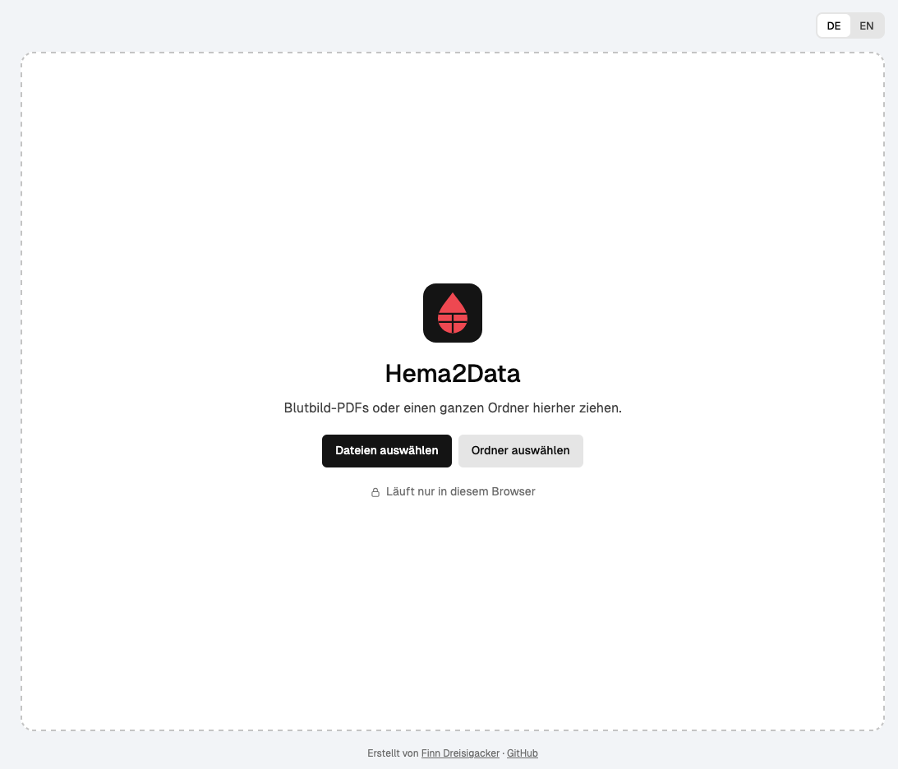

# Hema2Data

Turns blood count PDFs into a checked Excel file, entirely in the browser. `backend.py` runs unchanged in
[Pyodide](https://pyodide.org); PDFs never leave the computer.

**Open the app:** https://finn-dreisigacker.github.io/hema2data/



## Run locally

```bash
python3 -m http.server 8765
```

Open http://localhost:8765 (opening `index.html` directly from disk does not work: workers need a server).

## Why nothing is uploaded

- All libraries are in `vendor/` (Pyodide 0.27.7, pdfplumber, pdfminer.six, openpyxl, Geist font); no CDN, no tracking.
- The Content-Security-Policy in `index.html` allows connections only to the page's own origin, which only serves
  static files. The worker that runs Python is started from a blob URL, so the same policy applies there too.
- DevTools → Network shows no request while PDFs are read. After the first visit the app works offline.

## Notes

- `pypdfium2` and `cryptography` have no browser build and are stubbed in `worker.js`; `backend.py` needs neither.
  Encrypted PDFs therefore fail with a clear message.
